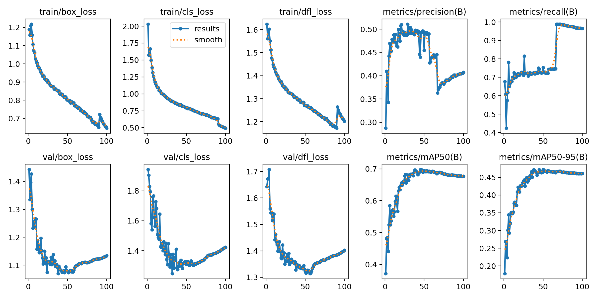

# 驾驶疲劳检测系统

驾驶疲劳检测项目，包含 **YOLO11 Web 演示版** 和 **YOLOv12 桌面检测版** 两套实现，涵盖图像检测、摄像头推理、视频处理、检测结果展示和模型训练流程。

桌面版包含已训练的四类专用检测权重，可以作为本机功能演示入口；Web 版提供眼部、嘴部检测接口与简化闭眼比例统计。两套实现的标签顺序和模型代码版本不同，分别运行，不能直接交换权重。

## 两个版本

|内容|YOLO11 Web 版|YOLOv12 桌面版|
|---|---|---|
|应用入口|根目录 `fatigue_app.py`|`desktop_yolov12/main.py`|
|界面|Flask + HTML + JavaScript|PyQt5 桌面 GUI|
|输入|图片、后端本机摄像头|图片、视频文件、本机摄像头|
|结果|检测 JSON、MJPEG、窗口统计|原图/检测图对比、检测表格、图片/视频保存|
|疲劳统计|30 次输入窗口的简化 PERCLOS|眼部/嘴部四类检测，未实现 PERCLOS 时间统计|
|权重|通用 `yolo11n.pt`，未附疲劳专用权重|专用 `desktop_yolov12/best.pt`，约 17.8 MiB|
|模型代码|依赖 `ultralytics==8.3.0`|ZIP 自带的 YOLOv12 兼容源码，版本标识 `8.3.63`|
|详细说明|[Web 版说明](docs/WEB_YOLO11.md)|[桌面版说明](docs/DESKTOP_YOLOV12.md)|

## 功能展示与工程组成

- **检测后端**：通过 YOLO 获得目标框、类别和置信度，OpenCV 完成图像与摄像头处理。
- **桌面界面**：检测线程通过 Qt 信号更新原图、检测图和表格，可调整置信度与 IoU 阈值。
- **视频输出**：处理本地视频并保存结果视频，支持保存图片检测结果或当前帧。
- **Web 接口**：图片上传、摄像头控制、MJPEG 视频流、疲劳统计查询。
- **训练流程**：YOLO11 的 VOC 转换及 CPU 训练脚本；YOLOv12 的四类数据配置与 GPU 训练脚本。
- **本地登录**：桌面版提供注册/登录演示；已有账号文件未发布，首次运行自行注册。

## 快速开始：桌面版

建议使用 Python 3.10，分别为两个版本创建环境。以下为 Windows PowerShell 命令：

```powershell
git clone https://github.com/JianhaoYu-AI/driver-fatigue-detection-system.git
cd driver-fatigue-detection-system
py -3.10 -m venv .venv-desktop
.\.venv-desktop\Scripts\python.exe -m pip install -r desktop_yolov12/requirements.txt
cd desktop_yolov12
..\.venv-desktop\Scripts\python.exe main.py
```

首次进入登录窗口时，点击“注册”创建自己的本地演示账号，密码至少 6 个字符。登录后选择图片、视频或摄像头进行检测。默认读取当前目录 `best.pt`；需在 `desktop_yolov12` 目录启动，使程序导入随项目提供的模型源码。

当前桌面依赖清单由原 ZIP 的模型依赖和实际代码导入整理而来，尚未在全新 Python 环境中完成 GUI/模型推理验证。若使用 CUDA，应检查 PyTorch 与显卡驱动的对应关系；该环境与 Web 版分别安装。

## 快速开始：Web 版

在仓库根目录运行：

```powershell
py -3.10 -m venv .venv-web
.\.venv-web\Scripts\python.exe -m pip install -r requirements.txt
.\.venv-web\Scripts\python.exe fatigue_app.py
```

访问 **http://127.0.0.1:5002**。当前 Web 版没有专用疲劳权重，会回退到通用 `yolo11n.pt`。通用模型的编号不能视为眼部/嘴部编号；必须完成与 Web 标签一致的专用训练，才可验证对应检测效果。桌面版的 `best.pt` 不能直接复制给 Web 版使用。

## 项目结构

```text
driver-fatigue-detection-system/
├── README.md
├── fatigue_app.py                 # YOLO11 Web 应用
├── requirements.txt               # Web 依赖
├── quick_start.py                 # 原 Web 交互启动入口
├── convert_fatigue_voc_to_yolo.py  # VOC 数据转换
├── train_fatigue.py               # YOLO11 训练
├── test_fatigue_model.py          # 合成图片流程演示
├── fatigue_data.yaml
├── yolo11n.pt                     # 通用初始化权重
├── templates/
├── static/
├── desktop_yolov12/
│   ├── main.py                    # 桌面程序入口
│   ├── UiMain.py                  # Qt 界面
│   ├── LoginWindow.py             # 本地注册/登录演示
│   ├── best.pt                    # 专用四类检测权重
│   ├── train.py
│   ├── data.yaml
│   ├── requirements.txt           # 桌面依赖
│   └── ultralytics/               # 保留的 YOLOv12 兼容模型源码
└── docs/
    ├── WEB_YOLO11.md
    ├── DESKTOP_YOLOV12.md
    ├── DATASET.md
    ├── VERIFICATION.md
    ├── THIRD_PARTY.md
    └── training_logs/             # 两次历史训练的 CSV、参数与曲线
```

## 数据集与类别

原始数据集 ZIP 共有 **16,246 张图片**，对应 16,246 份标注：训练 13,719 张、验证 1,380 张、测试 1,147 张。标注顺序与桌面专用权重一致，详见 [数据集说明](docs/DATASET.md)。

|编号|Web 标签|桌面/原始数据集标签|
|---:|---|---|
|0|`open_eye`|`Yawn`|
|1|`closed_eye`|`close`|
|2|`open_mouth`|`noYawn`|
|3|`closed_mouth`|`open`|

原始图片数据集未上传。复现实验时应自行准备已获授权的数据并设置本地路径；本仓库没有附该数据集的公开授权依据。

## 训练记录

保留两次原始训练记录：`exp100`（100 个 epoch）与 `exp117`（117 个 epoch），以及其参数和结果曲线。它们是原 ZIP 中的历史结果，**不是本次重新训练或独立验证的结果**；不能将 CSV 最后一个 epoch 的指标直接当作 `best.pt` 的指标。

[查看训练记录](docs/training_logs/) · [查看整理与验证状态](docs/VERIFICATION.md)



## 当前限制

- Web 版的窗口按输入次数累计，不是完整的时间型 PERCLOS；无眼睛检测时也会进入窗口分母。
- 桌面版展示眼部/嘴部检测结果，目前没有疲劳时间统计、语音告警或独立疲劳判定模块。
- Web 状态为进程内全局对象，适合本机单用户演示；桌面账号采用本地明文保存，属于演示实现。
- 本次未训练模型、打开摄像头或执行完整模型推理；真实准确率、帧率和可靠性仍需在目标环境验证。

## 第三方组件

项目中的 YOLO、PyTorch、OpenCV、Flask、PyQt5 等来自相应上游。桌面版保留原模型源码的许可证标识；详见 [第三方来源说明](docs/THIRD_PARTY.md)。项目功能、已有实现和待改进部分以源码及验证记录为准。
